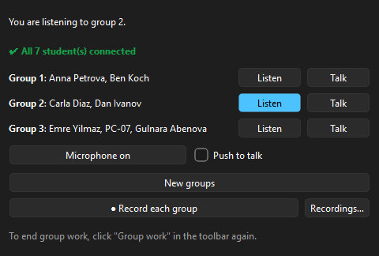
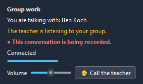
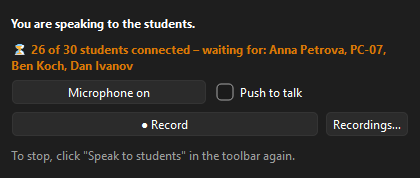
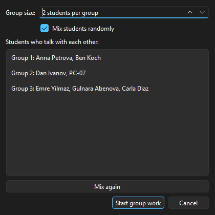
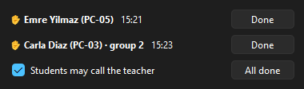
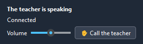
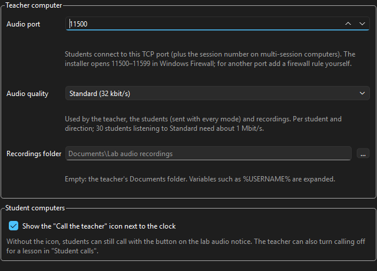
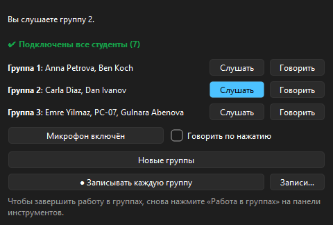
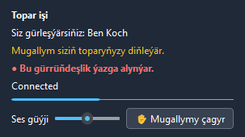

<h1 align="center">🎧 Veyon Lab Audio</h1>

<p align="center">
  <b>A language lab inside Veyon: live classroom audio, pair & group work, recording and "call the teacher" — on the network you already have.</b>
</p>

<p align="center">
  <a href="LICENSE"></a>
  
  
  
  
  
</p>

This is a fork of [**Veyon**](https://github.com/veyon/veyon), the free classroom management software.
Veyon already lets a teacher see and control every student screen. This fork adds the missing half of a
**language lab: sound.** The teacher speaks into the headsets of the whole class, talks with or listens to a
single student, sends students into pairs or small groups to practise speaking, drops in on any group, and
records conversations — for example oral exams. Students can call the teacher at any time.

Everything is built as Veyon plugins (`plugins/labaudio`, `plugins/labaudiocalls`) and shipped as one Windows
installer. No extra server, no cloud, no extra accounts: it uses the Veyon setup, authentication and computer
lists the school already has.

<p align="center">
  
  &nbsp;
  
</p>

---

## ✨ Features

| | For the teacher (Veyon Master) | What the students see |
|---|---|---|
| 📢 **Speak to students** | Your microphone in the headsets of the whole class or the selected students | "The teacher is speaking" |
| 💬 **Talk with student** | Two-way conversation with one student | "Talking with the teacher" + microphone level |
| 🎧 **Listen to student** | Hear one student's microphone | "The teacher can hear your microphone" — never secret |
| 👥 **Group work** | Pairs or groups of 2–6, mixed randomly or in order; **Listen** to or **Talk** with any group; **New groups** with one click | "Group work – You are talking with: Ben" and when the teacher is listening or has joined |
| ⏺ **Recording** | **● Record** the conversation, or **● Record each group** into its own file (oral exams) | "● This conversation is being recorded." |
| ✋ **Student calls** | "Students calling" window with name, computer, group and time; **Done**, **All done**; turn calling off during a test | ✋ tray icon next to the clock and ✋ button on the notice |
| 🎚 **Microphone control** | Microphone on/off and push-to-talk (button or Space) | — |
| 🔊 **Volume** | — | Volume slider 0–200 %, remembered per student |
| ✅ **Connection status** | "⏳ 26 of 30 students connected – waiting for: Anna, PC-07 …" → "✔ All 30 students connected" | "Connecting…" → "Connected" |
| ⚙️ **Settings** | "Lab audio" page in the Veyon Configurator: port, audio quality, recordings folder, call icon | — |

<table>
  <tr>
    <td align="center"><br><sub>Teacher panel while speaking to the class</sub></td>
    <td align="center"><br><sub>Starting group work</sub></td>
  </tr>
  <tr>
    <td align="center"><br><sub>Students calling the teacher</sub></td>
    <td align="center"><br><sub>Student notice: volume and ✋ call button</sub></td>
  </tr>
  <tr>
    <td align="center" colspan="2"><br><sub>"Lab audio" page in the Veyon Configurator</sub></td>
  </tr>
</table>

## 🧭 How it works

```
 Teacher PC                                                    Student PCs
┌───────────────────────────────┐                            ┌──────────────────────────────┐
│ Veyon Master                  │  Veyon's own encrypted     │ Veyon Server                 │
│  Lab audio toolbar & panels   │──── control channel ──────▶│  starts the audio client     │
│                               │   (start/stop, tokens)     │                              │
│ Veyon Server ─▶ Audio hub     │                            │ Audio client (user session)  │
│  (user session: your headset) │◀═══ TCP 11500, Opus ══════▶│  notice, volume, ✋ button   │
│  • mixes what you hear        │     AES-256-GCM            │  headset + microphone        │
│  • forwards group audio       │                            │                              │
│  • records to .opus files     │                            │ ✋ tray icon worker          │
└───────────────────────────────┘                            └──────────────────────────────┘
```

- **Control** uses Veyon's existing authenticated, encrypted Master ↔ Server connection, exactly like Veyon's own
  Demo mode. Only the audio itself has its own connection: one TCP stream per student to the teacher's PC.
- **Audio:** Opus, 48 kHz mono, 20 ms frames, 24–64 kbit/s (Standard: 32 kbit/s, about 4 kB/s per student).
  30 students listening to the teacher need about 1 Mbit/s. Students use their **Windows default headset**.
- **Smooth on Wi-Fi:** an adaptive jitter buffer (60–300 ms) grows after a hiccup and shrinks again once the network
  is calm; excess latency is drained inaudibly.
- **Fast start:** every student tries all of the teacher's network addresses at once and is connected about half a
  second after the teacher clicks.
- **Group work** goes through the teacher's hub, which forwards each student's audio to the other members of their
  group — students do not need to reach each other. No re-encoding on the teacher PC.
- **Recording** mixes the live streams in real time and writes standard **Ogg Opus** files
  (≈ 2.4 MB per 10 minutes) to `Documents\Lab audio recordings`, e.g. `2026-10-22 13-40-05 Group 2 - Carla, Dan.opus`.
- **Calls** travel over Veyon's own connection, so students can call even when no audio mode is running; a call waits
  until the teacher opens Veyon Master.

### 🔐 Security & privacy

- Every mode (and every group) gets a fresh random 512-bit key, delivered only over Veyon's authenticated channel.
  **The key never travels over the audio connection**: students prove they know it, and each connection derives its
  own AES-256 keys (HKDF-SHA256 with fresh nonces from both sides).
- **All audio and control frames are AES-256-GCM encrypted.** Modified, replayed or injected frames end the
  connection; nobody on the network can listen in or join a group.
- Students always see when the teacher is listening, has joined their group, or is recording.

## 🚀 Installation

1. Build the installer (see below) or take `veyon-<version>-labaudio-win64-setup.exe` from your build.
2. Copy the installer **together with `reinstall-veyon.cmd` and `reinstall-veyon.ps1`** (they are placed next to it)
   to every computer and double-click **`reinstall-veyon.cmd`**. It asks for administrator rights, removes the old
   Veyon silently, installs the new one and checks the result. The Veyon configuration (keys, locations) is kept.
   - Student computers without Veyon Master: `reinstall-veyon.cmd -NoMaster`
3. The installer adds the Windows Firewall rule **"Veyon Lab Audio"** (TCP 11500–11599 for `veyon-worker.exe`).
4. Install the **same version on all computers** — the encrypted audio protocol does not talk to older builds.

Everything else is ordinary Veyon setup (authentication keys, locations and computers) —
see the [Veyon documentation](https://docs.veyon.io/).

### 🎓 Quick guide for teachers

1. Students put on their headsets.
2. In Veyon Master open **Lab audio ▾** in the toolbar:
   - **Speak to students** — all computers shown in Veyon Master. For some students only, select their computers and
     use **Lab audio** in the right-click menu.
   - **Talk with student** / **Listen to student** — select exactly one computer first.
   - **Group work** — choose the group size, *Mix again* until you like the groups, *Start group work*
     (again all computers shown, or the selected ones via the right-click menu).
3. The panel next to Veyon Master shows who is connected, your microphone switch, push-to-talk and **● Record**.
4. Click the same toolbar button again to stop. **Student calls** in the toolbar opens the list of calling students.

## ⚙️ Settings

Veyon Configurator → **Lab audio**. The values are part of Veyon's configuration, so they can be exported once and
imported on every computer.

| Setting | Matters on | Default |
|---|---|---|
| Audio port (students connect to it) | teacher PC | 11500 |
| Audio quality: Speech 24 / Standard 32 / High 48 / Music 64 kbit/s | teacher PC (sent to the students) | Standard |
| Recordings folder (`%USERNAME%` etc. are expanded; empty = Documents) | teacher PC | empty |
| Show the "Call the teacher" icon next to the clock | student PCs | on |

## 🌍 Languages

English, **Русский** and **Türkmen**. Each computer uses the language chosen in the Veyon Configurator, otherwise
its Windows language. Veyon itself has no Turkmen translation; selecting Turkmen shows Veyon's own menus in English
and everything from Lab audio in Turkmen.

<p align="center">
  
  &nbsp;
  
</p>

All texts and translations live in [`translations/labaudio_translations.json`](translations/labaudio_translations.json);
the workflow for new texts is described in [the design notes](contrib/labaudio/LAB_AUDIO_DESIGN.md#languages).

## 🛠 Building from source

Windows build with a portable MSYS2 (UCRT64, GCC, Qt 6) — no Docker, no administrator rights needed:
[`contrib/labaudio/BUILD_WINDOWS.md`](contrib/labaudio/BUILD_WINDOWS.md).

```bash
cmake ../veyon-src -G Ninja -DCMAKE_BUILD_TYPE=Release -DWITH_WERROR=OFF -DWITH_TRANSLATIONS=OFF
ninja
bash ../veyon-src/contrib/labaudio/package-windows.sh   # -> dist/veyon-<version>-labaudio-win64-setup.exe
```

### 🧪 Tests

Standalone tests that run without a Veyon installation (`plugins/labaudio/selftest`):

| Program | Checks |
|---|---|
| `labaudio_selftest` | framing, Opus round trip, jitter buffer and mixing, resampling, volume, encryption (tampering, replay, wrong key), call state, Ogg Opus files (checksums, headers, timing, decoded level) |
| `labaudio_grouptest` | the real hub with simulated students: group routing, encryption on the wire, forged keys, teacher status, recording each group, connection status, connect time when students start before the hub; `--ui <dir>` renders all windows |
| `labaudio_loopback` | hub and client on one PC with the real headset: `labaudio_loopback 12 speak\|listen\|talk [record]` |

## 📂 What this fork adds

| Path | |
|---|---|
| [`plugins/labaudio`](plugins/labaudio) | Lab audio plugin: modes, teacher panels, audio hub and client, Opus engine, encryption, recording, settings page |
| [`plugins/labaudiocalls`](plugins/labaudiocalls) | "Call the teacher": tray icon, call state in Veyon Server, calls window |
| [`contrib/labaudio`](contrib/labaudio) | [design notes](contrib/labaudio/LAB_AUDIO_DESIGN.md), Windows build guide, packaging and reinstall scripts, icon generator, translation script |
| `translations/labaudio_*.ts` | Russian and Turkmen translations |
| `CMakeLists.txt`, `cmake/modules/…` | small build fixes for native MSYS2 builds (64-bit detection, optional `-Werror`) |

The upstream Veyon sources are otherwise unchanged; the original Veyon README is kept as
[`README.veyon.md`](README.veyon.md).

## ⚠️ Notes

- Windows only (the audio engine uses Qt Multimedia/WASAPI; Veyon itself also runs on Linux).
- Headsets are strongly recommended — with loudspeakers group members hear themselves as an echo.
- Recording students may need their consent under your school's rules; the notice informs them, it does not ask.
- The Turkmen texts deserve a review by a native speaker.

## 📜 License & credits

GNU General Public License v2, like Veyon — see [LICENSE](LICENSE).

- [Veyon](https://veyon.io) by Tobias Junghans and the Veyon contributors — the foundation this fork builds on.
- [Opus](https://opus-codec.org) audio codec, [OpenSSL](https://www.openssl.org), [Qt](https://www.qt.io).
